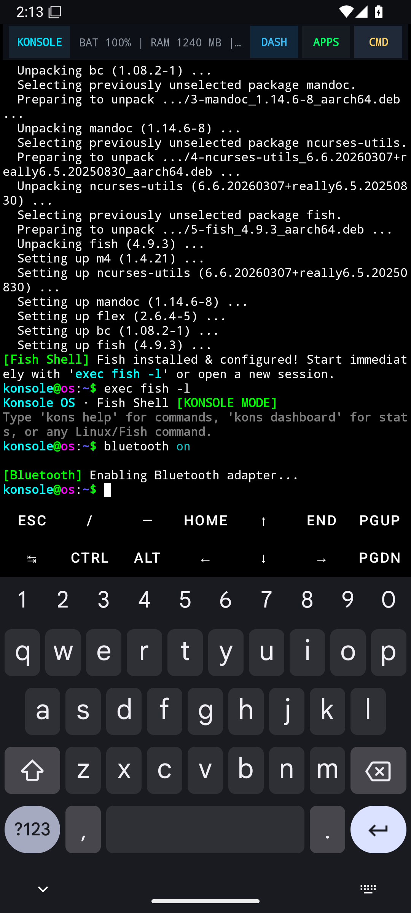
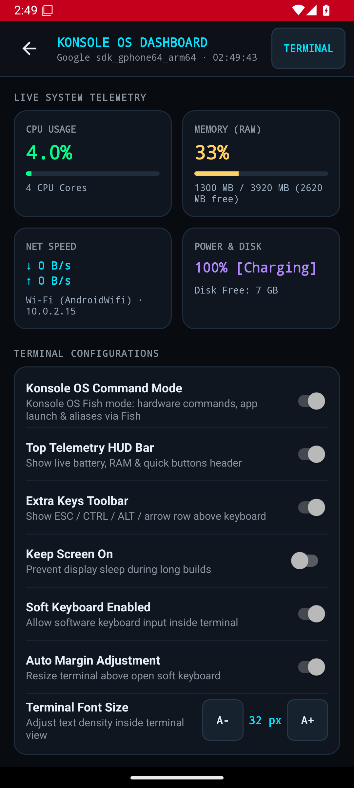

# Konsole OS (v1.0.0-premier)

Konsole OS is an advanced Android terminal OS environment, launcher, and professional toolkit combining a touch-friendly Fish terminal, Termux-compatible Linux userspace, Proot distro management, KeX X11 desktop, rootless packet capture, network/RF recon, USB-OTG serial bridge, and hardware-backed KeyStore vault.


**Start here:** [Quickstart](#quickstart) · [Comparison Matrix](#konsole-os-vs-similar-projects) · [User Guide](docs/USER_GUIDE.md) · [Developer Guide](docs/DEVELOPER_GUIDE.md) · [Security](SECURITY.md) · [License](LICENSE.md)

## Table of contents

- [Konsole OS vs Similar Projects](#konsole-os-vs-similar-projects)
- [Screenshots](#screenshots)
- [Features](#features)
- [Technology](#technology)
- [Prerequisites](#prerequisites)
- [Quickstart](#quickstart)
- [Build configuration](#build-configuration)
- [Documentation](#documentation)
- [Contributing](#contributing)

---

## Konsole OS vs Similar Projects

How does **Konsole OS v1.0.0-premier** compare against popular Android terminal, distribution, and launcher ecosystems?

| Feature / Capability | Konsole OS v1.0.0-premier | Kali NetHunter (Rootless / Full) | UserLAnd | T-UI / Termux-based Launchers | Standard Termux |
| :--- | :--- | :--- | :--- | :--- | :--- |
| **Root Required** | **Rootless** (works out-of-the-box on stock Android) | Partial (Rootless via PRoot) or Full (Kernel/ROM flash required) | **Rootless** (PRoot Debian/Ubuntu/Arch) | **Rootless** (Terminal launcher) | **Rootless** (Standard shell) |
| **Terminal Shell & UX** | Fish shell + Touch HUD + App Drawer + Command Palette | Bash / Zsh (Standard NetHunter terminal) | Standard Linux shell inside PRoot app view | Text-only TUI command launcher | Bash / Zsh / Fish inside standard terminal view |
| **Proot Distro Manager** | Built-in manager (`kons distro` / Workstation Hub) | Built-in Kali NetHunter Chroot/PRoot | Debian, Ubuntu, Arch, Alpine GUI app picker | None | Manual `pkg install proot-distro` |
| **KeX VNC Desktop** | Integrated KeX VNC manager (`kons kex :1`) | NetHunter KeX XServer client app | VNC client handoff required | None | Manual X11/VNC setup |
| **Rootless Packet Capture** | Built-in `VpnService` writing standard `.pcap` (`LINKTYPE_RAW`) | Requires tcpdump + root (or PCAPdroid) | Requires tcpdump inside PRoot | None | Manual tcpdump (root/pcap permission) |
| **Network & TLS Recon** | Built-in port scanner, ARP/interfaces, TLS cert inspector, Wi-Fi BSS survey, BLE & mDNS | Full suite of native Kali security tools (requires root/chroot) | Basic Linux CLI tools via apt | None | Manual apt packages |
| **USB-OTG Serial / UART** | Built-in `UsbManager` UART bridge (FTDI, CH340, CP210x, CDC-ACM) | External USB HID/serial tools (requires kernel support) | Limited USB device passthrough | None | Limited USB access |
| **Security & KeyStore Vault** | Hardware `AndroidKeyStore` AES-256-GCM + PBKDF2 passphrase + Panic lockdown | Standard Linux file permissions | Standard PRoot container files | Standard app storage | Standard app storage |
| **XML UI & Shade Customization** | Fully customizable via `$konsole/customize/*.xml` & custom Shade tiles | Fixed Kali theme | Default Linux desktop theme | Basic TUI settings | Basic properties file |
| **Plugin Ecosystem** | `$konsole/plugins/` (launchable & extension hooks, SHA-256 verification) | NetHunter App Store / Magisk modules | None | None | Termux plugins (`:API`, `:Styling`, etc.) |

---

## Screenshots

The repository includes Android captures of the app's terminal, dashboard, app launcher, command palette, and macro workflow.

| Terminal | System Dashboard | Pro Workstation Hub |
| --- | --- | --- |
|  |  | Proot, KeX, PCAP, RF & Vault Hub |

---

## Features

- **Pro Workstation Hub**: Unrooted Kali NetHunter–inspired control center for Proot distros, KeX VNC desktops, daemon management (`sshd`, `tor`, `http`, `adb`), rootless PCAP sniffing, network/TLS/RF recon, and USB-OTG UART serial communication.
- **Hardware-Backed KeyStore Vault**: App-private `AndroidKeyStore` AES-256-GCM secret storage, PBKDF2 passphrase hashing, and a one-tap **Panic Lockdown** (`kons lock --panic`) that locks the vault, terminates active packet capture, and wipes ephemeral incognito files.
- **Fully XML-Customizable OS & Shade**: Configure colors, fonts, layouts, and Quick-Control notification Shade tiles via `$konsole/customize/*.xml` and workspace profiles (`default`, `lab`, `stealth`).
- **Plugin Architecture**: Install launchable and extension plugins from local directories or GitHub ZIP templates (`$konsole/plugins/`), complete with manifest validation, SHA-256 digest checks, and permission consent dialogs.
- **Advanced Automation & Macro Lab**: Cron scheduling, interval triggers, event-driven triggers (battery, Wi-Fi, screen, Bluetooth, notifications, app launches), constraints, and multi-step action execution.
- **Robust Linux Userspace**: Bundled Termux bootstrap (`apt-android-7`), Fish shell integration, persistent user variables & aliases, and Android IPC via the `RUN_COMMAND` service.

---

## Technology

| Area | Implementation |
| --- | --- |
| Android application | Java/Kotlin, Android SDK, AndroidX, Material Components, Jetpack Compose UI elements |
| Build | Gradle 8.13.2 Android Gradle Plugin, Gradle wrapper |
| Terminal | `terminal-emulator` and `terminal-view` Android library modules |
| Shared platform code | `termux-shared` module |
| Native code | C/C++ built with Android NDK/ndk-build |
| Linux userspace | Termux bootstrap archives (`apt-android-7`) |
| Markdown UI | Markwon |
| CI | GitHub Actions; unit tests run with JUnit and Robolectric |

The Android app has no server-side database. Terminal files, package state, and encrypted secrets live in the app's private Android storage; Android preferences store app settings. Packages are obtained through configured Termux repositories from inside the app.

---

## Prerequisites

- JDK 17 for the documented CI-compatible build environment.
- Android SDK Platform 36 and Android build tools available to Gradle.
- Android NDK `29.0.14206865` (declared in `gradle.properties`).
- Android Studio is optional but useful for editing and running on an emulator/device.

---

## Quickstart

```bash
git clone https://github.com/hunter-zen-RU/Konsole-OS.git
cd Konsole-OS
./gradlew assembleDebug
```

Gradle downloads the required bootstrap archives during the build and verifies their SHA-256 checksums. Install the resulting `app/build/outputs/apk/debug/app-debug.apk` on an Android device or emulator.

To run unit tests or build a release APK:

```bash
./gradlew testDebugUnitTest
./gradlew assembleRelease
```

---

## Build configuration

Project defaults are in `gradle.properties`: `minSdkVersion=21`, `targetSdkVersion=28`, `compileSdkVersion=36`, and `ndkVersion=29.0.14206865`. `TERMUX_PACKAGE_VARIANT` selects the bootstrap (`apt-android-7` by default).

---

## Documentation

- [User Guide](docs/USER_GUIDE.md): install/use the app, configure its dashboard and troubleshoot common issues.
- [Developer Guide](docs/DEVELOPER_GUIDE.md): architecture, modules, build/test workflows, Android integration API, CI and contribution notes.
- [Security policy](SECURITY.md)
- [License](LICENSE.md)

---

## Contributing

Contributions are welcome. Review the [Developer Guide](docs/DEVELOPER_GUIDE.md#contributing) and [security policy](SECURITY.md), make a focused change on a branch, run `./gradlew testDebugUnitTest`, and submit a pull request.

[Back to top](#konsole-os-v100-premier)
