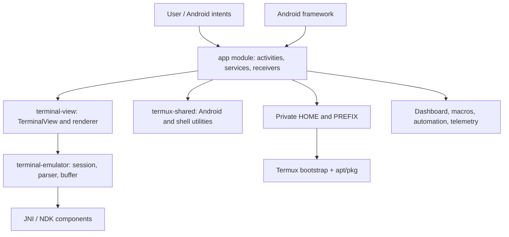

# Konsole OS Developer Guide

**Documentation:** [Project overview and quickstart](../README.md) · [Documentation home](en/index.md) · [User Guide](USER_GUIDE.md) · [Security policy](../SECURITY.md) · [License](../LICENSE.md)

## Table of contents

- [Architecture](#architecture)
  - [Application lifecycle and data paths](#application-lifecycle-and-data-paths)
- [Directory structure](#directory-structure)
- [Setup and development workflow](#setup-and-development-workflow)
  - [Build variables](#build-variables)
- [Android integration reference](#android-integration-reference)
  - [Konsole command dispatcher](#konsole-command-dispatcher)
  - [Macro model and persistence](#macro-model-and-persistence)
  - [RUN_COMMAND service](#run_command-integration)
  - [Other app-facing modules](#other-app-facing-modules)
  - [Configuration XML reference](#configuration-xml-reference)
  - [Example macro JSON](#example-macro-json)
- [Deployment and CI](#deployment-and-ci)
- [Contributing](#contributing)

## Architecture

The app is a native Android application. `app` owns the Android activities, services, receivers, preferences, bootstrap installation, and Konsole-specific UI/automation. It delegates terminal state and emulation to the terminal modules and shared Android/Termux utilities to `termux-shared`. Interactive shell processes execute in the app's private Termux filesystem.



The principal flow is: Android launches an activity or service; the app creates/attaches a terminal session; the terminal view renders the emulator buffer and forwards input; the session communicates with the shell process in the app's private userspace. Macro and `RUN_COMMAND` flows dispatch commands through app services rather than an HTTP API. The repository does not define a server or database schema.

### Application lifecycle and data paths

`TermuxApplication` initializes process-wide state. `TermuxActivity` is the exported launcher/terminal activity, starts or binds terminal services and provides the navigation surface. `TermuxInstaller` installs the bootstrap into the Termux prefix. `TermuxService` owns shell/session execution, while `RunCommandService` adapts third-party Android intents into executions. `SystemEventReceiver`, cron receiver, and macro trigger receiver connect Android broadcasts/alarms to Konsole automation. `KonsoleFishBridge` uses files under `$PREFIX/var/run/konsole-ipc/{req,resp}` and a file observer to bridge Fish command requests to native Android command handlers.

There are two principal storage domains: Termux's private app sandbox (`$HOME` and `$PREFIX`) for shell, packages and runtime IPC; and `/storage/emulated/0/Konsole` for user-visible configuration and package/plugin directories when storage permission is available. The terminal shell shares the app UID, so Android shared-storage permission controls direct shell access as well as Java file I/O. `TermuxActivity` requests `READ_EXTERNAL_STORAGE` and `WRITE_EXTERNAL_STORAGE` alongside the app's other runtime permissions, rechecks on resume, then initializes the Konsole directory and calls `TermuxInstaller.setupStorageSymlinks`. `KonsoleConfigManager.init` now defers shared-folder initialization unless access is granted and primary external storage is mounted. Macro JSON and history have private app-files fallbacks. Settings use Android shared preferences. These are files/preferences, not a relational database.

## Directory structure

```text
.
├── app/
│   └── src/main/java/com/termux/app/       # Android application, terminal integration, Konsole features
│       ├── konsole/                        # Dashboard, macros, command dispatch, triggers, telemetry
│       ├── activities/                     # Help and settings screens
│       └── api/file/                       # Android file share/view receiver
├── terminal-emulator/                      # Terminal parser, buffer, session, JNI and unit tests
├── terminal-view/                          # Android terminal rendering, touch/selection and view client
├── termux-shared/                          # Shared Android, shell, preference, file and notification helpers
├── app/src/main/res/                       # Android layouts, drawables, XML settings and strings
├── app/src/main/cpp/                       # App native bootstrap and C code
├── art/                                    # Branding and asset generation scripts
├── public/assets/aistudio/                 # Included Konsole UI screenshot captures
├── docs/                                   # Project documentation
├── fastlane/                               # Store/release metadata
├── site/                                   # Project site content
├── .github/workflows/                      # Build, test, release and dependency workflows
├── gradle/                                 # Gradle wrapper
├── settings.gradle                         # Four included Gradle modules
└── gradle.properties                       # SDK, NDK and shared build defaults
```

`fastlane/` and `site/` are present, but their contents are not required for local app builds. The app's Android components and intent filters are declared in `app/src/main/AndroidManifest.xml`.

For the user interface reference images, see [the screenshot gallery in the User Guide](USER_GUIDE.md#screenshots). The captures are repository assets and may reflect a particular build/device state rather than the current UI exactly.

Useful source landmarks:

| Path | Role |
| --- | --- |
| `app/src/main/java/com/termux/app/TermuxActivity.java` | Main terminal activity and Android lifecycle/UI integration. |
| `app/src/main/java/com/termux/app/TermuxService.java` | Session and command service. |
| `app/src/main/java/com/termux/app/TermuxInstaller.java` | Bootstrap and prefix installation/repair helpers. |
| `app/src/main/java/com/termux/app/RunCommandService.java` | External Android `RUN_COMMAND` adapter. |
| `app/src/main/java/com/termux/app/konsole/` | Konsole dashboard, shell bridge, telemetry, commands, macros, alarms and accessibility integration. |
| `app/src/main/res/layout/` | Terminal, dashboard, app list, palette, macro editor and settings layouts. |
| `app/src/main/res/xml/` | Settings definitions, shortcuts, provider paths, device admin and accessibility-service metadata. |
| `terminal-emulator/src/main/java/com/termux/terminal/` | Emulator/session model and terminal protocol implementation. |
| `terminal-view/src/main/java/com/termux/view/` | Android rendering, gesture handling, text selection, and view client. |
| `termux-shared/src/main/java/com/termux/shared/` | Cross-cutting Android, shell, files, logging, permissions, and Termux compatibility helpers. |

## Setup and development workflow

Install JDK 17, Android SDK Platform 36, and NDK `29.0.14206865`, then build from the repository root:

```bash
./gradlew assembleDebug
./gradlew testDebugUnitTest
./gradlew assembleRelease
```

Tests are local JVM tests, primarily JUnit/Robolectric. The terminal emulator and app both contain unit tests. Instrumented tests are present in `termux-shared`; run them on a configured device/emulator with `./gradlew connectedDebugAndroidTest`.

The build downloads the selected Termux bootstrap archives and checks their SHA-256 hashes. To download them explicitly, run `./gradlew downloadBootstraps`. A working network is needed when archives are not already present. `clean` removes downloaded bootstrap archives as well as normal Gradle outputs.

No separate formatter or linter task is configured in the root build. Android lint is part of Android tooling; the app build explicitly disables the `ProtectedPermissions` lint check. Keep Java at source/target compatibility 8 and follow `.editorconfig` for text formatting.

### Build variables

| Variable/property | Purpose | Default/source |
| --- | --- | --- |
| `compileSdkVersion` | Android compile API | `36` in `gradle.properties` |
| `minSdkVersion` / `targetSdkVersion` | Supported/minimum and target API | `21` / `28` |
| `ndkVersion` | Native build toolchain | `29.0.14206865` |
| `TERMUX_PACKAGE_VARIANT` | Bootstrap variant | `apt-android-7`; also supports `apt-android-5` |
| `TERMUX_APP_VERSION_NAME` | Override app version name | `app/build.gradle` default `1.0.0-premier` |
| `TERMUX_APK_VERSION_TAG` | APK version tag input | Optional |
| `TERMUX_SPLIT_APKS_FOR_DEBUG_BUILDS` / `TERMUX_SPLIT_APKS_FOR_RELEASE_BUILDS` | Split APK build controls | `1` / `0` |
| `JITPACK_NDK_VERSION` | NDK override in library/JitPack builds | Falls back to project property |
| `KEYSTORE_FILE`, `KEYSTORE_PASSWORD`, `KEY_ALIAS`, `KEY_PASSWORD` | Release signing | Optional; see README warning |

There is no `.env.example`; these are build variables, not runtime environment configuration for the Android app.

## Android integration reference

### Konsole command dispatcher

`KonsoleCommandDispatcher` is a singleton called by the terminal integration and Fish bridge. `handleCommand(Context, TerminalSession, String)` returns `true` when the input was handled natively and `false` when it should be passed to the PTY shell. Before routing, it applies mode checks, variable expansion and alias substitution. Native routes include dashboard/apps/palette/macro UI, shell variables and aliases, telemetry, Android device controls, package/plugin operations, and app launch by label. `executeBridgeCommand(Context, String, CommandSink)` is the Fish IPC entry point; its sink receives output and a completion exit code. Failures are reported through terminal output or a nonzero/127 status.

The `kons` command surface is documented at runtime by `kons help`; its dispatcher includes `apps`, `set`, `notify`, `toast`, `alias`, `list`, `install`, `update`, `run`, `search`, `remove`, `sys`/`status`, `hud`, `palette`, `dashboard`, `macro`, `setup-fish`, `version`/`about`, `help`, and `switch`. Additional top-level native routes appear in `KonsoleCommandDispatcher` and may require Android permissions. Avoid treating this internal dispatcher as a stable third-party API.

### Macro model and persistence

`KonsoleMacroRule` is a JSON-serializable rule; `KonsoleMacroStore` loads/saves rules, selects the most recently modified primary/fallback file and keeps a bounded execution history. The top-level document is `{ "version": 1, "updatedAtMs": <epoch-ms>, "macros": [...] }`. A rule has `id`, `name`, `description`, `enabled`, `triggerType`, `triggerValue`, `constraints`, `actions`, and execution summary fields. Unknown trigger/action strings fall back to `MANUAL`/`SHELL` respectively.

| Field | Shape / supported values |
| --- | --- |
| `triggerType` | `MANUAL`, `CRON`, `INTERVAL`, `BATTERY_LOW`, `BATTERY_OKAY`, `POWER_CONNECTED`, `POWER_DISCONNECTED`, `WIFI_CONNECTED`, `WIFI_DISCONNECTED`, `SCREEN_ON`, `SCREEN_OFF`, `BLUETOOTH_ON`, `HEADSET_PLUGGED`, `NOTIFICATION`, `APP_OPENED` |
| `triggerValue` | Trigger-specific text; cron expression for `CRON`, minutes for `INTERVAL`, optional matching text for notification/app triggers. |
| `constraints` | `requireCharging`, `requireDischarging`, `minBattery`, `maxBattery`, `requireWifi`, `requireScreenOn`, `ssidFilter`. |
| `actions[]` | `{ "type": ..., "param1": "", "param2": "", "param3": "" }`; action types `SHELL`, `SHELL_SESSION`, `FLASHLIGHT`, `NOTIFICATION`, `TOAST`, `VIBRATE`, `LAUNCH_APP`, `INTENT_URL`, `TAP`, `SWIPE`. |

The executor evaluates actions in array order and aggregates output and exit status. Shell action variables are exported to the command; the constraint evaluator provides device/trigger values for substitutions. A failed constraint prevents normal trigger execution, although the manual/CLI path has an explicit forced-execution option. `KonsoleCronParser` supports five fields (minute, hour, day-of-month, month, day-of-week), wildcards, lists, ranges and steps, plus `@hourly`, `@daily`, `@midnight`, `@weekly`, and `@every_1m/5m/15m/30m`. Sunday accepts 0 or 7. Cron next-fire calculation searches at most 366 days.

<a id="run_command-integration"></a>

### `RUN_COMMAND` service

`RunCommandService` implements the Termux-compatible Android intent service. It accepts the action `${applicationId}.RUN_COMMAND` (the app's application ID is `com.termux`) and requires the app-specific `com.termux.permission.RUN_COMMAND` permission. The caller must obtain runtime/user-granted permission before invoking it. This is Android IPC; there are no HTTP routes.

Core intent fields read by the service include:

| Extra | Type | Meaning |
| --- | --- | --- |
| `com.termux.RUN_COMMAND_PATH` | String | Required executable path |
| `com.termux.RUN_COMMAND_ARGUMENTS` | String[] | Executable arguments |
| `com.termux.RUN_COMMAND_WORKDIR` | String | Working directory |
| `com.termux.RUN_COMMAND_STDIN` | String | Standard input text |
| `com.termux.RUN_COMMAND_RUNNER` | String | Runner selection |
| `com.termux.RUN_COMMAND_BACKGROUND` | boolean (deprecated) | Selects background runner when no explicit runner is supplied |
| `com.termux.RUN_COMMAND_PENDING_INTENT` | PendingIntent | Optional result callback |
| `com.termux.RUN_COMMAND_RESULT_DIRECTORY` | String | Optional result file output location |

The constants are defined in `TermuxConstants.TERMUX_APP.RUN_COMMAND_SERVICE`; use those constants or the published [Termux RUN_COMMAND contract](https://github.com/termux/termux-app/wiki/RUN_COMMAND-Intent) rather than hard-coding assumptions. The service validates the action and mandatory executable extra, constructs an execution command, forwards it to `TermuxService`, and can return status/output through the configured result callback or files. Other supported extras cover shell/session behavior, command labels/descriptions/help, output format, and comma alternatives; consult `RunCommandService` and the constants for the complete contract.

Example shape (Java; constants abbreviated for readability):

```java
Intent intent = new Intent("com.termux.RUN_COMMAND");
intent.setClassName("com.termux", "com.termux.app.RunCommandService");
intent.putExtra("com.termux.RUN_COMMAND_PATH", "/data/data/com.termux/files/usr/bin/echo");
intent.putExtra("com.termux.RUN_COMMAND_ARGUMENTS", new String[] { "hello" });
intent.putExtra("com.termux.RUN_COMMAND_WORKDIR", "/data/data/com.termux/files/home");
intent.putExtra("com.termux.RUN_COMMAND_BACKGROUND", true);
context.startService(intent);
```

The caller must have the app-specific permission; Android may require a foreground service start or user interaction depending on OS version and execution mode. See the in-code help URL and API contract before shipping a client.

### Other app-facing modules

- `terminal-emulator`: `TerminalSession`, `TerminalEmulator`, `TerminalBuffer`, and `TerminalOutput` implement shell session lifecycle, parsing, screen/history storage, and output callbacks.
- `terminal-view`: `TerminalView` is the Android view; `TerminalViewClient` is the interaction callback boundary; `TerminalRenderer` paints emulator contents.
- `termux-shared`: reusable Android, filesystem, shell execution, preferences, notification, and local-socket utilities. These modules publish Maven artifacts as `com.termux:terminal-emulator`, `com.termux:terminal-view`, and `com.termux:termux-shared`, version `0.118.0`, through their Gradle publication configuration.

Important internal components include `KonsoleConfigManager` (XML configuration and aliases/variables), `KonsoleTelemetryManager` (live dashboard and shell values), `KonsolePathIndexer` (verified paths), `KonsoleAutomationEngine` (triggers/schedules/CLI), `KonsoleConstraintEvaluator` (runtime conditions and injected values), `KonsoleMacroExecutor` (ordered shell/native actions), and `KonsoleCommandDispatcher` (terminal command interception). Activities are presentation/controller boundaries; Android service and receiver components are declared in the manifest.

| Module | Public/important types | Responsibility |
| --- | --- | --- |
| `terminal-emulator` | `TerminalSession`, `TerminalSessionClient`, `TerminalEmulator`, `TerminalBuffer`, `TerminalOutput` | Process/session lifecycle, terminal control-sequence parsing, scrollback/screen data, and output callbacks. |
| `terminal-view` | `TerminalView`, `TerminalViewClient` | Android `View` for display/input and host callback contract. It exposes the emulator module as an API dependency. |
| `termux-shared` | `TermuxConstants`, shell command/environment classes, `TermuxBootstrap`, file/preferences utilities | Reusable platform behavior shared by Termux-derived apps. |
| `app` | `TermuxActivity`, `TermuxService`, `RunCommandService`, Konsole classes | Installed app, lifecycle, Android components, and user-facing features. |

These are Android/library APIs rather than a web endpoint catalog. Prefer module source and public Javadocs for exact visibility/signatures when embedding a module. The core state and callbacks evolve with the emulator implementation, so application consumers should pin a tested library version.

### Configuration XML reference

On initialization, `KonsoleConfigManager` creates `/storage/emulated/0/Konsole/customize/` and default `ui.xml`, `behavior.xml`, `aliases.xml`, `variables.xml`, and `init.kons` if absent. XML is loaded into in-memory maps and persisted when setter methods are called. The default UI values are `textColor=#00FF66`, `promptColor=#00E5FF`, `fontSize=14`, `cursorStyle=BLOCK`, `transparency=0.95`, `gridColumns=4`, and `statusBarVisible=true`. Behavior defaults include `mode=konsole`, `autoCompleteKey=RIGHT_ARROW`, and `hapticFeedback=true`. The app writes generated variable documentation to `$konsole/variable.txt`.

The XML manager escapes values on write, but property names become XML element names. Treat custom config as user data and validate names before writing. `init.kons` is created as a file; whether a startup path consumes it depends on shell/bootstrap setup.

### Example macro JSON

This illustrates the actual serialized shape; action parameter meaning depends on the action type. It does not enable the rule by itself unless imported/saved by the app:

```json
{
  "version": 1,
  "updatedAtMs": 0,
  "macros": [
    {
      "id": "sample-health-log",
      "name": "Periodic status log",
      "description": "Append a short health line",
      "enabled": false,
      "triggerType": "CRON",
      "triggerValue": "*/15 * * * *",
      "constraints": {
        "requireCharging": false,
        "requireDischarging": false,
        "minBattery": 0,
        "maxBattery": 100,
        "requireWifi": false,
        "requireScreenOn": false,
        "ssidFilter": ""
      },
      "actions": [
        {
          "type": "SHELL",
          "param1": "echo status >> $HOME/status.log",
          "param2": "",
          "param3": ""
        }
      ],
      "runCount": 0,
      "lastRunTimeMs": 0,
      "lastRunSummary": "Never run"
    }
  ]
}
```

Avoid directly editing the active JSON while the app is running. The UI persists the current in-memory rule list and may overwrite out-of-band changes. For backups/import-style editing, close the Macro Lab/app first, preserve a copy, and validate JSON before reopening.

## Deployment and CI

GitHub Actions workflows cover Android release builds, debug builds, unit tests, Gradle wrapper validation, dependency submission, release APK attachment, and JitPack library build triggering. The unit-test workflow uses Temurin JDK 17 and runs `./gradlew testDebugUnitTest --no-daemon`. The release workflow builds on `v*` tags or manual dispatch, runs `downloadBootstraps` and `assembleRelease`, then packages APK artifacts. Review `.github/workflows/` for current triggers and signing behavior.

| Workflow | Purpose from checked-in configuration |
| --- | --- |
| `run_tests.yml` | Runs the Gradle unit-test task on pushes/PRs to configured branches and manual dispatch. |
| `android-BUILD.yml` | Builds release artifacts for version tags/manual release workflow. |
| `build-debug-app.yml`, `debug_build.yml` | Debug APK build automation. |
| `attach_debug_apks_to_release.yml` | Attaches debug APK artifacts to releases. |
| `gradle-wrapper-validation.yml` | Validates the checked-in Gradle wrapper. |
| `dependency-submission.yml` | Submits dependency graph information. |
| `trigger_library_builds_on_jitpack.yml` | Integrates module/library builds with JitPack. |

The app build task is configured to download/check bootstrap archives for supported package variants before Java/native compilation. The current default variant is `apt-android-7`, versioned in the app build script; checksums for each architecture are embedded beside the download logic. CI release automation may create a fallback debug keystore if a supplied keystore artifact is absent. Thus a successfully signed CI APK is not automatically a production-key release; validate the signing identity before publishing it to users.

For a local release build, supply a release keystore through the variables above and run `./gradlew assembleRelease`. The app module enables R8 minification for release. APK split configuration is currently disabled in the app's Android `splits` block.

## Contributing

The repository does not define a formal branch naming or PR template convention. Use a focused branch and commit, describe user-visible and architectural effects in the pull request, link relevant issues, and include device/API-level details for Android behavior changes. Before requesting review:

1. Run `./gradlew testDebugUnitTest` and the relevant module/build task.
2. Build `./gradlew assembleDebug` for changes affecting app resources, manifest, Java or native build setup.
3. Update user/developer documentation for changed settings, integrations, or workflows.
4. Confirm permissions, exported Android components, and intent inputs remain appropriately validated.
5. Never include signing credentials or private keys in a change.

See [SECURITY.md](../SECURITY.md) for vulnerability reporting and [LICENSE.md](../LICENSE.md) for licensing.

[Back to top](#konsole-os-developer-guide)
